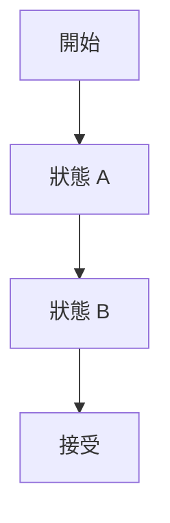
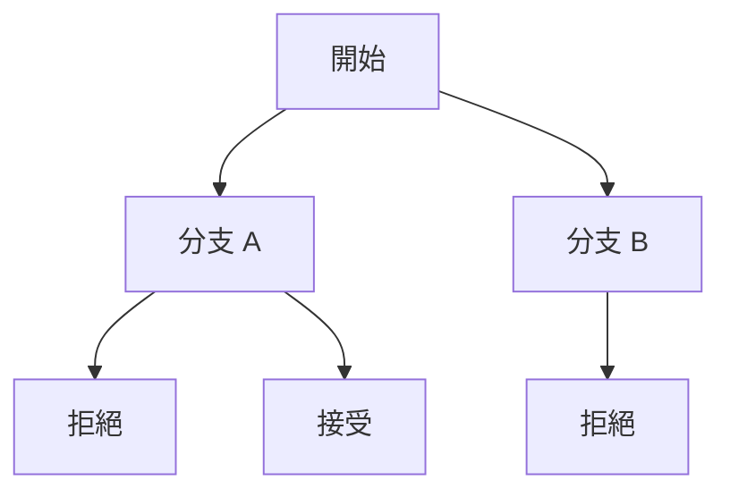
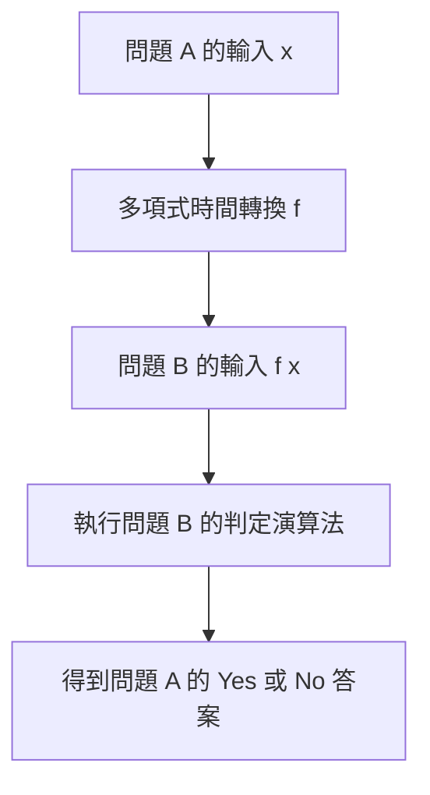
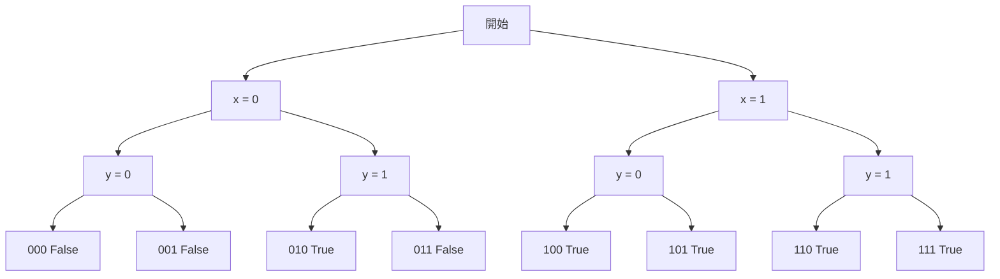
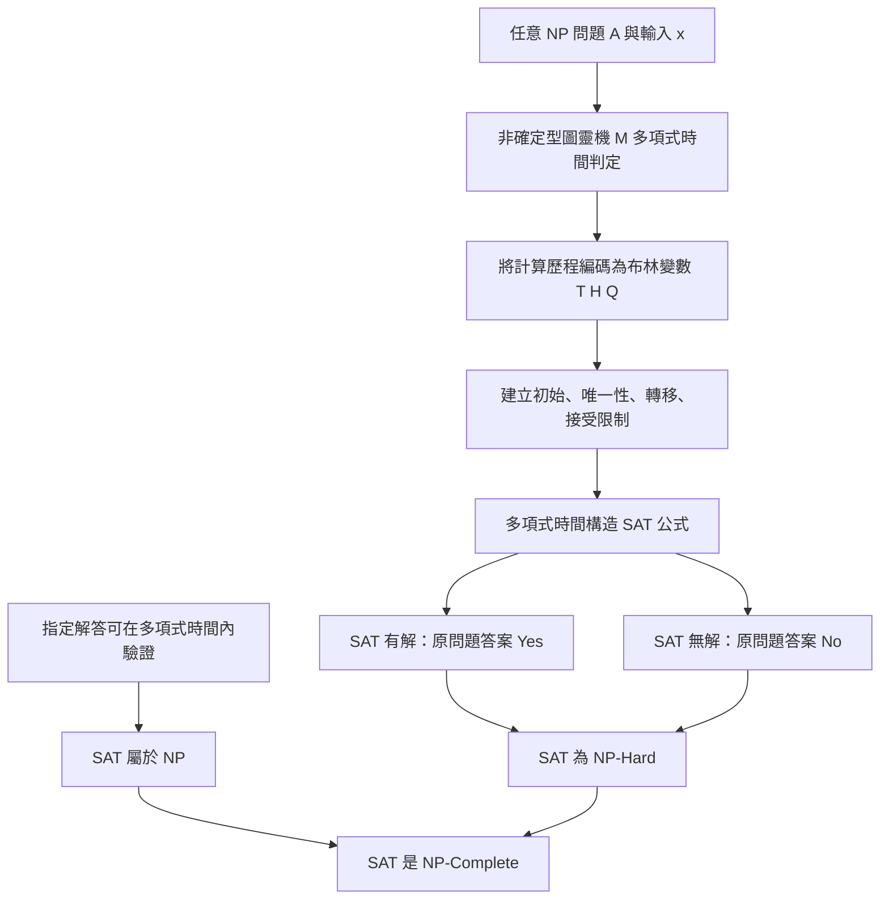

# 計算理論 Ch06－庫克的證明（Cook–Levin Theorem）重點筆記

> 教材來源：[GitHub－06 庫克的證明](https://github.com/ccc115a/alg/blob/main/04-%E7%90%86%E8%AB%96/01-%E8%A8%88%E7%AE%97%E7%90%86%E8%AB%96/_book/06-%E5%BA%AB%E5%85%8B%E7%9A%84%E8%AD%89%E6%98%8E.md)  
> 本筆記由 ChatGPT（AI）協助整理，適合課堂複習與考前準備；部分定義依標準計算複雜度理論補充或修正。

本章主要探討計算複雜度（Computational Complexity），研究哪些問題可以有效率地求解，以及不同問題之間如何透過轉換建立關係。

**本章核心結論：SAT 是 NP-Complete 問題。如果 SAT 能在多項式時間內求解，那麼 P = NP。**

## 目錄

1. [圖靈機](#一圖靈機turing-machine)
2. [P、NP 問題](#二pnp-問題)
3. [NP-Hard 與 NP-Complete](#三np-hard-與-np-complete)
4. [Reduction 歸約法](#四reduction歸約法)
5. [SAT 布林可滿足性問題](#五sat-布林可滿足性問題)
6. [使用暴力法解決 SAT](#六使用暴力法解決-sat)
7. [庫克定理與完整證明](#七庫克定理cooklevin-theorem)
8. [庫克定理的重要性](#八庫克定理的重要性)
9. [考試常見錯誤](#九考試常見錯誤整理)
10. [考前模擬試題](#十考前模擬試題)
11. [申論題必背答案](#十一申論題必背答案)
12. [考前一分鐘速讀](#十二考前一分鐘速讀)

---

## 一、圖靈機（Turing Machine）

圖靈機是一種抽象的計算模型，用來描述電腦可以執行哪些計算。基本組成包含磁帶、讀寫頭、有限狀態集合與狀態轉移規則。

### 1. 確定型圖靈機（DTM）

Deterministic Turing Machine：在相同狀態與相同輸入符號下，至多有一種下一步的執行方式。



### 2. 非確定型圖靈機（NTM）

Nondeterministic Turing Machine：在相同狀態與輸入符號下，可以有多種下一步的執行方式，形成不同的計算分支。



| 比較項目 | DTM | NTM |
|---|---|---|
| 下一步狀態 | 至多一種 | 可以有多種 |
| 執行路徑 | 單一路徑 | 多條分支 |
| 計算模型 | 確定性運算 | 理論上的非確定性運算 |
| 多項式時間所定義的類別 | P | NP |

非確定型圖靈機的狀態轉移函數（採用只允許向左或向右移動的模型）：

$$
\delta: Q\times\Gamma\rightarrow 2^{Q\times\Gamma\times\{L,R\}}
$$

- $Q$：狀態集合。
- $\Gamma$：磁帶字母表。
- $L,R$：讀寫頭移動方向。
- $2^A$：集合 $A$ 的冪集。

**考試注意：** 標準 NTM 只要存在一條接受路徑，就接受該輸入。即使其他分支拒絕，也不影響結果。多項式時間 NTM 的所有計算分支都必須在指定的多項式時間上限內停止。原教材對接受與拒絕分支的部分敘述應依此標準定義理解。

---

## 二、P、NP 問題

### 1. P（Polynomial Time）

可以使用確定型演算法，在多項式時間內解決的判定問題。

常見的多項式時間上界：

$$
O(1),\ O(\log n),\ O(n),\ O(n^2),\ O(n^3)
$$

例如：判斷圖中兩點是否連通、判斷最短路徑是否不超過指定長度、判斷整數是否為質數。

### 2. NP（Nondeterministic Polynomial Time）

可以使用非確定型圖靈機在多項式時間內解決的判定問題。

等價的驗證定義：如果答案為 Yes，便存在一份長度為多項式大小的解答證明（certificate），可以由確定型演算法在多項式時間內驗證；若答案為 No，則不存在能通過驗證的證明。

例如廣義數獨：尋找完整解答可能需要大量搜尋，但若有人提供答案，就能快速檢查各列、各行及各區塊是否符合規則。

| 比較項目 | P | NP |
|---|---|---|
| 多項式時間求解 | 可以 | 不一定已知可以 |
| 多項式時間驗證 Yes 解答 | 可以 | 可以 |
| 英文全名 | Polynomial Time | Nondeterministic Polynomial Time |
| 集合關係 | P 是 NP 的子集合 | 包含 P |

### 3. P = NP 問題

目前已知：

$$
P\subseteq NP
$$

但仍未證明 $P=NP$ 或 $P\ne NP$。

核心問題：**如果一個問題的 Yes 答案可以快速驗證，是否也代表這個判定問題可以快速求解？**

注意：NP 並不是 Non-Polynomial，也不代表所有 NP 問題都需要指數時間。

---

## 三、NP-Hard 與 NP-Complete

### 1. NP-Hard（NP 困難）

如果所有 NP 問題都可以在多項式時間內歸約成判定問題 B，那麼 B 就是 NP-Hard：

$$
\forall A\in NP,\quad A\leq_p B
$$

NP-Hard 不一定屬於 NP。對最佳化問題也可使用適當的多項式時間歸約概念定義其 NP-Hard 性質，因此 NP-Hard 問題不一定是判定問題。

### 2. NP-Complete（NP 完全）

必須同時符合兩個條件：

1. 本身屬於 NP。
2. 本身屬於 NP-Hard。

$$
\boxed{NP\text{-}Complete=NP\cap NP\text{-}Hard}
$$

| 類別 | 多項式時間求解 | 多項式時間驗證 Yes 證明 | 代表問題 |
|---|---|---|---|
| P | 可以 | 可以 | 最短路徑判定 |
| NP | 不一定已知 | 可以 | SAT |
| NP-Hard | 不一定 | 不一定 | TSP 最佳化版 |
| NP-Complete | 尚無已知通用多項式時間演算法 | 可以 | SAT、3-SAT |

在假設 $P\ne NP$ 時，P 位於 NP 中且與 NP-Complete 不相交；NP-Complete 則是 NP 和 NP-Hard 的交集。這個集合圖是基於尚未證明的假設，不能當作已知結論。

**重要推論：** 任意一個 NP-Complete 問題若有多項式時間演算法，所有 NP 問題也都能在多項式時間內求解，因此 P = NP。

---

## 四、Reduction（歸約法）

### 1. 基本概念

歸約就是將問題 A 轉換成問題 B，利用問題 B 的演算法解決原本的問題 A。

$$
A\leq_p B
$$

代表 A 可以在多項式時間內歸約成 B。



正式的多項式時間多對一歸約必須滿足：

$$
x\in A\iff f(x)\in B
$$

也就是轉換前後的 Yes、No 答案必須一致。

### 2. 歸約的方向（考試必考）

假設 $A\leq_p B$：

| 已知條件 | 可以推論 |
|---|---|
| B 屬於 P | A 也屬於 P |
| A 是 NP-Hard | B 也是 NP-Hard |
| A 是 NP-Complete，且 B 屬於 NP | B 是 NP-Complete |
| A 屬於 P | 無法判斷 B 是否屬於 P |

**記憶方式：容易程度往左傳，困難程度往右傳。**

### 3. 教材範例：八皇后轉換成整數規劃

在 8 × 8 棋盤上放置 8 個皇后，並且不能互相攻擊。

一組可行解如下（Q 代表皇后）：

```text
. . Q . . . . .
. . . . . . . Q
. . . Q . . . .
. . . . . . Q .
Q . . . . . . .
. . . . . Q . .
. Q . . . . . .
. . . . Q . . .
```

將棋盤上的每個位置定義為二元變數：

$$
x_{ij}\in\{0,1\}
$$

1 代表放置皇后，0 代表沒有放置皇后。

| 限制條件 | 數學表示 |
|---|---|
| 每一橫列恰好一個皇后 | $\sum_j x_{ij}=1$ |
| 每一直行恰好一個皇后 | $\sum_i x_{ij}=1$ |
| 每條反斜線最多一個皇后 | $\sum_{i-j=k}x_{ij}\leq 1$ |
| 每條正斜線最多一個皇后 | $\sum_{i+j=k}x_{ij}\leq 1$ |

教材使用 Python 的 `mip` 整數規劃套件，將棋盤限制轉換成數學模型，再交由求解器處理。

這個範例的目的不是證明八皇后為 NP-Complete，而是理解不同問題可透過數學轉換使用同一種求解方法。

---

## 五、SAT 布林可滿足性問題

SAT 全名為 Boolean Satisfiability Problem，目的是判斷是否存在一組布林變數的值，使整個邏輯運算式為 True。

### 1. 基本邏輯符號

| 符號 | Python | 意義 |
|---|---|---|
| $\land$ | `and` | 且 |
| $\lor$ | `or` | 或 |
| $\neg$ | `not` | 否定 |
| 1 | `True` | 真 |
| 0 | `False` | 假 |

### 2. SAT 範例

$$
F=(x\lor y)\land(x\lor\neg z)
$$

建立真值表：

| x | y | z | x ∨ y | x ∨ ¬z | F |
|---|---|---|---|---|---|
| 0 | 0 | 0 | 0 | 1 | 0 |
| 0 | 0 | 1 | 0 | 0 | 0 |
| 0 | 1 | 0 | 1 | 1 | **1** |
| 0 | 1 | 1 | 1 | 0 | 0 |
| 1 | 0 | 0 | 1 | 1 | **1** |
| 1 | 0 | 1 | 1 | 1 | **1** |
| 1 | 1 | 0 | 1 | 1 | **1** |
| 1 | 1 | 1 | 1 | 1 | **1** |

只要存在一組結果為 1，就代表此邏輯式可以被滿足（Satisfiable）。例如 x=0、y=1、z=0。

### 3. 練習：自行代入變數

試著代入 x=0、y=1、z=1，計算 F 的結果。

<details>
<summary>查看答案</summary>

- x ∨ y = 1
- x ∨ ¬z = 0
- F = 1 ∧ 0 = 0

這組變數無法滿足 F，但其他組合可以，因此原式仍是可滿足的。

</details>

### 4. 無解的情況（UNSAT）

$$
F=x\land\neg x
$$

無論 x 是 0 或 1，結果都一定是 False。因此這個布林式是 Unsatisfiable（不可滿足）。

---

## 六、使用暴力法解決 SAT

假設布林式中有 n 個變數，每個變數只有 0、1 兩種可能，因此總組合數量為 $2^n$。

| 變數數量 n | 可能組合數 $2^n$ |
|---:|---:|
| 5 | 32 |
| 10 | 1,024 |
| 20 | 1,048,576 |
| 30 | 1,073,741,824 |
| 40 | 1,099,511,627,776 |
| 50 | 1,125,899,906,842,624 |

每增加一個變數，組合數量就增加為原本的兩倍。

### 1. Python 暴力法範例

```python
from itertools import product


def SAT():
    for x, y, z in product([False, True], repeat=3):
        result = (x or y) and (x or not z)
        if result:
            return x, y, z
    return None


print(SAT())
```

預期輸出：

```text
(False, True, False)
```

這是使用 Python 標準函式庫的簡化範例，不需額外安裝套件。

### 2. 教材的遞迴搜尋概念



DFS 依序搜尋 0、1 分支，找到第一組可行解 010 後即可停止。

### 3. 時間複雜度

令 n 為變數數量，m 為布林式長度。假設一次變數查值為常數時間。

| 操作 | 時間複雜度 |
|---|---|
| 驗證一組指定答案 | $O(m)$ |
| 所有可能指派的數量 | $2^n$ |
| 逐一驗證所有組合（最壞情況） | $O(2^n m)$ |

如果還要逐一產生並複製完整指派，亦可能增加 $O(n)$ 的每次列舉成本。一般 SAT 輸入中實際出現的變數數量不超過公式長度，因此整體上界仍可寫作 $O(2^n m)$。

**注意：** 暴力法是指數時間，不代表所有 SAT 演算法都必須花費指數時間。目前尚未證明一般 SAT 不存在多項式時間演算法。

---

## 七、庫克定理（Cook–Levin Theorem）

### 1. 定理內容

$$
\boxed{SAT\text{ is NP-Complete}}
$$

必須證明兩件事：

$$
SAT\in NP
$$

$$
\forall A\in NP,\quad A\leq_p SAT
$$

第一個條件代表 SAT 屬於 NP，第二個條件代表 SAT 屬於 NP-Hard。

### 2. 第一部分：證明 SAT 屬於 NP

假設有人提供一組布林變數的值。只需要將這組值代入布林式，就能檢查整個式子是否成立。

指派的大小及驗證時間均為輸入大小的多項式，因此：

$$
SAT\in NP
$$

### 3. 第二部分：證明所有 NP 問題都能歸約成 SAT

假設有任意一個 NP 問題 A，由一台非確定型圖靈機 M 在多項式時間內判定。

庫克的想法是將圖靈機的整個計算過程轉換成一個布林邏輯式。這個邏輯式必須描述磁帶內容、讀寫頭位置、目前狀態、狀態轉移與接受條件。

若邏輯式存在可行解，就代表圖靈機存在一條合法的接受路徑；反過來，若圖靈機存在接受路徑，就可以用該路徑建立滿足邏輯式的指派。

### 4. 圖靈機的三種布林變數

| 變數 | 代表意義 |
|---|---|
| $T_{i,j,k}$ | 第 k 步時，磁帶第 i 格是否為符號 j |
| $H_{i,k}$ | 第 k 步時，讀寫頭是否位於第 i 格 |
| $Q_{q,k}$ | 第 k 步時，圖靈機是否處於狀態 q |

例如：

```text
                  目前狀態 q
                      |
                      v
位置：    1   2   3   4   5   6   7
磁帶：  [ 0 | 1 | 1 | 0 | 1 | □ | □ ]
                      ^
                    讀寫頭
```

此時 $H_{4,k}=1$、$T_{4,0,k}=1$、$Q_{q,k}=1$。

### 5. 將圖靈機限制轉換成布林式

| 限制條件 | 說明 |
|---|---|
| 磁帶限制 | 每一格在同一時間只能有一個符號 |
| 讀寫頭限制 | 同一時間恰好位於一個位置 |
| 狀態限制 | 同一時間恰好處於一個狀態 |
| 初始條件 | 必須從指定的輸入、讀寫頭位置及初始狀態開始 |
| 轉移條件 | 每一步必須符合圖靈機的合法轉移規則，未被寫入的磁帶格維持原值 |
| 接受條件 | 計算過程必須到達接受狀態 |

將上述限制全部使用 AND 連接：

$$
\Phi=C_{\text{tape}}\land C_{\text{head}}\land C_{\text{state}}\land C_{\text{start}}\land C_{\text{move}}\land C_{\text{accept}}
$$

例如，若某個磁帶格只能取 0 或 1，便可以用下面的公式表示「恰好有一個符號」：

$$
(T_{i,0,k}\lor T_{i,1,k})\land(\neg T_{i,0,k}\lor\neg T_{i,1,k})
$$

第一個子句要求至少有一個符號，第二個子句要求不能同時有兩個符號。

若 $\Phi$ 可以被滿足，就表示存在一個合法且成功的圖靈機計算過程。對任意輸入 x，構造的公式 $\Phi_x$ 必須滿足：

$$
x\in A\iff \Phi_x\text{ is satisfiable}
$$

### 6. 為什麼轉換是多項式時間？

假設圖靈機最多需要 $p(n)$ 步，而 $p(n)$ 是多項式，並可假設 $p(n)\geq n$。單帶圖靈機需要記錄的磁帶範圍也是多項式大小。

可以將計算歷程表示成二維表格（Computation Tableau）：

| 時間／磁帶位置 | 1 | 2 | 3 | 4 | 5 | … |
|---|---|---|---|---|---|---|
| t = 0 | q₀, 1 | 0 | 1 | □ | □ | … |
| t = 1 | 1 | q₁, 0 | 1 | □ | □ | … |
| t = 2 | … | … | … | … | … | … |
| … | … | … | … | … | … | … |
| t = p(n) | … | … | qₐ, 0 | … | … | … |

表格中的每一列代表某個時間點的圖靈機組態，含有狀態的格子表示讀寫頭所在的位置。可令接受狀態允許保持組態不變，以便將提早接受的計算補齊至 $p(n)$ 步。

若執行時間為 $O(n^c)$，磁帶使用範圍亦為 $O(n^c)$，則表格大小為：

$$
O(n^c)\times O(n^c)=O(n^{2c})
$$

由於 c 是固定常數，因此表格仍為多項式大小。利用局部狀態轉移限制與唯一性限制，可在多項式時間內建立對應的布林式。

注意：表格大小是 $O(p(n)^2)$；具體公式大小依編碼方式而異，但只要仍為多項式，就足以證明歸約成立。不需要列舉 NTM 所有可能的計算分支。

### 7. 完整證明流程圖



### 8. 證明結論

由於 SAT 本身屬於 NP，且任意 NP 問題皆可在多項式時間內歸約成 SAT，因此 SAT 是 NP-Complete。

$$
\boxed{SAT\in NP\ \land\ SAT\text{ is NP-Hard}\ \Longrightarrow\ SAT\text{ is NP-Complete}}
$$

---

## 八、庫克定理的重要性

庫克定理建立了第一個 NP-Complete 問題。後續研究者不必重新從圖靈機開始證明，而可以利用已知的 NP-Complete 問題進行歸約。

| 問題 | 中文名稱 | 分類 |
|---|---|---|
| SAT | 布林可滿足性問題 | NP-Complete |
| 3-SAT | 三文字可滿足性問題 | NP-Complete |
| Clique | 團問題（判定版） | NP-Complete |
| Vertex Cover | 頂點覆蓋問題（判定版） | NP-Complete |
| Hamiltonian Cycle | 漢米爾頓迴路問題 | NP-Complete |
| Subset Sum | 子集合總和問題 | NP-Complete |
| TSP（判定版） | 是否有長度不超過 K 的旅行路線 | NP-Complete |
| TSP（最佳化版） | 尋找最短旅行路線 | NP-Hard |
| 0-1 Integer Programming（可行性） | 二元整數規劃問題 | NP-Complete |

若想證明一個新問題 B 為 NP-Complete，可以證明：

$$
SAT\leq_p B
$$

再證明：

$$
B\in NP
$$

即可得出 B 是 NP-Complete。也可使用其他已知 NP-Complete 問題代替 SAT。

---

## 九、考試常見錯誤整理

| 錯誤觀念 | 正確觀念 |
|---|---|
| NP 就是 Non-Polynomial | NP 是 Nondeterministic Polynomial Time |
| NP 問題一定很難 | P 問題也屬於 NP |
| P 和 NP 沒有交集 | P 是 NP 的子集合 |
| NP-Hard 一定屬於 NP | 不一定 |
| NP-Complete 一定需要指數時間 | 尚未證明 |
| SAT 必須所有組合都成立 | 只需要一組成立 |
| NTM 必須所有分支接受 | 只要存在一條接受分支 |
| 若 A 可歸約到 B，A 容易就代表 B 容易 | 錯誤，方向相反 |
| 庫克證明了 P ≠ NP | 庫克證明的是 SAT 為 NP-Complete |
| 使用暴力法很慢就代表問題是 NP-Complete | 必須透過正式證明 |

---

## 十、考前模擬試題

### 第 1 題：NP 的英文全名為何？

- A. Non-Polynomial Time
- B. Nondeterministic Polynomial Time
- C. Normal Polynomial Time
- D. Non-Programming Time

### 第 2 題：下列何者是目前已知正確的關係？

- A. NP ⊆ P
- B. P 與 NP 無交集
- C. P ⊆ NP
- D. P ≠ NP 已被證明

### 第 3 題：若 $A\leq_p B$，且 B 屬於 P，則何者正確？

- A. A 屬於 P
- B. A 一定是 NP-Hard
- C. B 一定是 NP-Complete
- D. 無法推論 A

### 第 4 題：具有 n 個布林變數的 SAT 問題共有多少種可能指派？

- A. n
- B. n²
- C. 2n
- D. 2ⁿ

### 第 5 題：庫克定理證明了什麼？

- A. P = NP
- B. SAT 是 NP-Complete
- C. P ≠ NP
- D. 所有 NP 問題都無解

### 第 6 題：若任意一個 NP-Complete 問題可以在多項式時間內求解，會得到什麼結論？

- A. P = NP
- B. P ≠ NP
- C. SAT 不屬於 NP
- D. 所有演算法均為指數時間

<details>
<summary>展開正確答案與解析</summary>

| 題號 | 答案 | 解析 |
|---|---|---|
| 1 | B | NP 是非確定型多項式時間。 |
| 2 | C | 可在多項式時間內求解的判定問題也屬於 NP。 |
| 3 | A | 利用多項式時間轉換及 B 的多項式時間演算法即可求解 A。 |
| 4 | D | 每個變數有兩種選擇，因此總共為 2ⁿ 種。 |
| 5 | B | SAT 屬於 NP，且所有 NP 問題皆能多項式歸約成 SAT。 |
| 6 | A | 所有 NP 問題都能歸約至該問題，因此可得 NP ⊆ P，再結合 P ⊆ NP。 |

</details>

---

## 十一、申論題必背答案

### 第 1 題：請說明 P 與 NP 的差異。

P 是確定型圖靈機可以在多項式時間內解決的判定問題；NP 是非確定型圖靈機可以在多項式時間內解決的判定問題，也就是 Yes 解答具有可在多項式時間內驗證的證明。目前已知 P 是 NP 的子集合，但尚未證明兩者是否相等。

### 第 2 題：什麼是 NP-Complete？

一個問題如果本身屬於 NP，且所有 NP 問題都可以在多項式時間內歸約成該問題，則稱為 NP-Complete 問題。

### 第 3 題：請說明庫克定理的證明方式。

首先證明 SAT 的指定解答可以在多項式時間內驗證，因此 SAT 屬於 NP。接著將任意 NP 問題的非確定型圖靈機計算過程，使用布林變數及邏輯限制表示，並在多項式時間內轉換為 SAT 問題，因此 SAT 屬於 NP-Hard。由於 SAT 同時屬於 NP 與 NP-Hard，所以 SAT 是 NP-Complete。

### 第 4 題：為什麼只要找到一個 NP-Complete 問題的多項式時間演算法，就能證明 P = NP？

因為所有 NP 問題都可以在多項式時間內歸約成任意一個 NP-Complete 問題。如果該 NP-Complete 問題具有多項式時間演算法，則所有 NP 問題也都可以在多項式時間內解決，因此 NP ⊆ P。再根據已知的 P ⊆ NP，即可得到 P = NP。

---

## 十二、考前一分鐘速讀

| 關鍵字 | 必背內容 |
|---|---|
| DTM | 確定型圖靈機 |
| NTM | 非確定型圖靈機 |
| P | 多項式時間求解 |
| NP | 多項式時間驗證 Yes 解答 |
| NP-Hard | 所有 NP 問題都可多項式時間歸約至它 |
| NP-Complete | NP 與 NP-Hard 的交集 |
| Reduction | 將問題轉換成另一個問題 |
| SAT | 判斷是否存在使布林式成立的指派 |
| 暴力搜尋 | 2ⁿ 種組合 |
| Cook–Levin | 證明 SAT 是 NP-Complete |
| T | 磁帶符號 |
| H | 讀寫頭位置 |
| Q | 圖靈機狀態 |

### 五個必背公式

$$
\boxed{P\subseteq NP}
$$

$$
\boxed{NP\text{-}Complete=NP\cap NP\text{-}Hard}
$$

$$
\boxed{SAT\in NP}
$$

$$
\boxed{\forall A\in NP,\quad A\leq_p SAT}
$$

$$
\boxed{SAT\in P\implies P=NP}
$$

---

## 檔案說明

- 格式：Markdown（UTF-8）。
- 公式：LaTeX 數學語法；GitHub 支援渲染。
- 流程圖：Mermaid 語法；GitHub 支援渲染。
- 聊天中的互動式 SAT 練習、測驗與圖表已轉為 Markdown 靜態表格、流程圖及可展開的答案。
- 本筆記由 AI 協助整理，部分內容為標準理論補充，並非原教材逐字轉錄。
